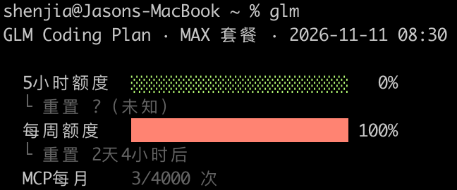

# glm-quota

GLM Coding Plan（智谱 BigModel）配额查询 + 分档提醒工具。单文件 Python 脚本，零依赖，macOS 双通道推送（手机 Bark + Mac 通知中心）。

| 终端查询 | 恢复推送 |
| :---: | :---: |
|  |  |

## 功能

- **配额查询**：5小时额度 / 每周额度 / MCP 每月调用次数，带进度条和重置倒计时
- **监控模式**（`--watch`）：按阈值分档推送（默认 50% 温和预警 + 95% 紧急提醒），每档每周期只推一次
- **双额度门控**：任何推送（阈值预警 / 恢复通知）都要求 5小时 + 每周两个额度同时可用——任一已满（100%）即静默挂起，等两者都可用时再推，避免「说能干活其实干不了」的误导推送
- **零依赖**：纯标准库，Python 3.8+ 直接运行（自动探测 certifi / 系统证书）

## 安装

```bash
git clone https://github.com/shenjia/glm-quota.git
cd glm-quota
chmod +x glm
ln -sf "$(pwd)/glm" /usr/local/bin/glm   # 或 ~/.local/bin/glm（确保在 PATH 中）
```

## 配置

API Key 读取顺序：`--api-key` > `$GLM_API_KEY` / `$ZHIPU_API_KEY` > `~/.claude/glm-router/upstream.key` > `~/.claude/settings.json`（Claude Code 用户可零配置）。

推送 key（可选）读取顺序：`--bark-key` > `$BARK_KEY` > `~/.glm-quota.env`。未配置时跳过手机推送，仅用 Mac 通知中心。

`~/.glm-quota.env`（dotenv 格式，chmod 600，不入仓库）：

```dotenv
BARK_KEY=你的Bark推送key
# GLM_API_KEY=你的智谱APIKey   （可选，优先级低于进程环境变量）
```

> Bark key 等于手机推送的"门钥匙"，注意不要提交到任何公开仓库。

## 使用

```bash
glm                 # 查询当前配额
glm --json          # 输出原始 JSON
glm --watch         # 监控模式（默认阈值 50,95）
glm --watch --threshold 80        # 单档提醒
glm --watch --threshold 50,80,95  # 多档提醒（支持 50-95 区间写法）
glm --reset-state   # 清除已推送状态（调试用）
```

### watch 推送规则

| 场景 | 行为 |
| - | - |
| 5小时用量达阈值，两额度可用 | 推预警（每档每周期一次） |
| 5小时用量达阈值，但周额度已满 | 静默（反正干不了活），不记档；周额度恢复后同周期内补推 |
| 5小时重置回落，两额度可用 | 推「配额已重置，可以继续干活了」 |
| 5小时重置回落，但周额度已满 | 挂起恢复通知，等周额度重置后再推 |
| 状态文件 | `~/.glm-quota-state.json` |

### launchd 定时监控示例

`~/Library/LaunchAgents/com.glm-quota.watch.plist`（每 15 分钟查一次）：

```xml
<?xml version="1.0" encoding="UTF-8"?>
<!DOCTYPE plist PUBLIC "-//Apple//DTD PLIST 1.0//EN" "http://www.apple.com/DTDs/PropertyList-1.0.dtd">
<plist version="1.0"><dict>
  <key>Label</key><string>com.glm-quota.watch</string>
  <key>ProgramArguments</key>
  <array><string>/usr/local/bin/glm</string><string>--watch</string></array>
  <key>StartInterval</key><integer>900</integer>
  <key>StandardErrorPath</key><string>/tmp/glm-quota.err</string>
</dict></plist>
```

```bash
launchctl load ~/Library/LaunchAgents/com.glm-quota.watch.plist
```

## License

MIT
